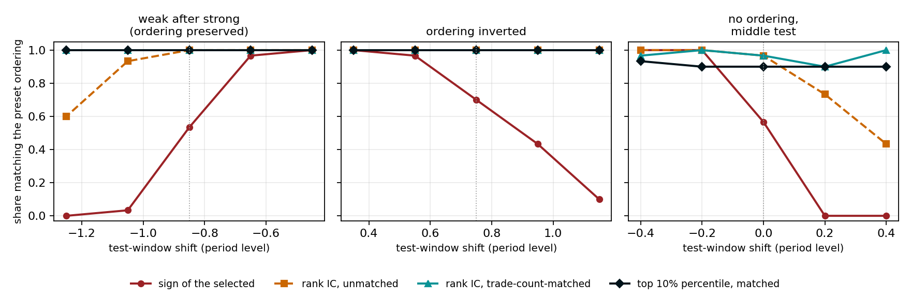

# Selection Procedure Portability

[](https://doi.org/10.5281/zenodo.23324761)

Cite as: Kiriakov, M. (2026). The sign of the selected candidate's P&L conflates the level of the test period with the quality of selection. Zenodo. https://doi.org/10.5281/zenodo.23324761

Matvey Kiriakov

Selection Procedure Portability (SPP) reads one out-of-sample step of a selection rule: the sum of the candidate that was frozen in-sample, and where that slice sits in the candidate set. A comparison with candidates of the same trade count sits beside the sum. It does not replace the sum.

The paper is [Selection Procedure Portability](Selection%20Procedure%20Portability.md).

The sign of the selected follows how strong the test period was. The place of the frozen slice does not:



## Read a table

The library is `scripts/spp/` (NumPy only). It does not download prices or run a backtest. From `scripts/`:

```python
import numpy as np
from spp import gap_matched, selection_report, top_index

# 20 candidates. Weak test period, in-sample order kept.
train_score = np.arange(20, 0, -1, dtype=float)
test_values = -5.0 * np.arange(1, 21)
trade_count = np.array(
    [300, 450, 310, 440, 320, 430, 330, 420, 340, 410,
     350, 400, 360, 390, 370, 380, 305, 445, 315, 435],
    dtype=float,
)

chosen = top_index(train_score, 0.10)
report = selection_report(train_score, test_values, fraction=0.10)
matched = gap_matched(test_values, chosen, trade_count)

print(report["champion_value"], report["champion_place"])
print(report["place"], report["gap_exact"])
print(matched["gap_matched"])
```

This prints:

```
-5.0 95.0
92.5 45.0
40.0
```

The champion is in the red, so the usual walk-forward sign is a minus. The frozen top 10% still sit at the top of the set (`place` 92.5). The third number is the trade-count-matched gap: a side reading, not a replacement for the sum.

`train_score`, `test_values` and `trade_count` must be the same length and the same row order. Details are in [scripts/spp/README.md](scripts/spp/README.md).

## Reproduce the testbed

From the repository root, run the commands in Appendix C of the paper, except `spp_live_table.py` and `spp_build_article.py`. Those two are not in this repository: the historical matrices are not published.

Run them strictly in that order. Later scripts read files that earlier ones write (for example `spp_ribbon_study.py` needs the thresholds from `spp_worlds_study.py`), so a script run alone on a fresh clone fails with a missing-file error.

Install the requirements with `pip install -r requirements.txt`. The studies need NumPy; regenerating the figures also needs matplotlib, after `spp_baseline_study.py` has written its results.

## License

The paper and figures are [CC BY 4.0](https://creativecommons.org/licenses/by/4.0/): reuse with attribution. The code in `scripts/` is [MIT](LICENSE).
