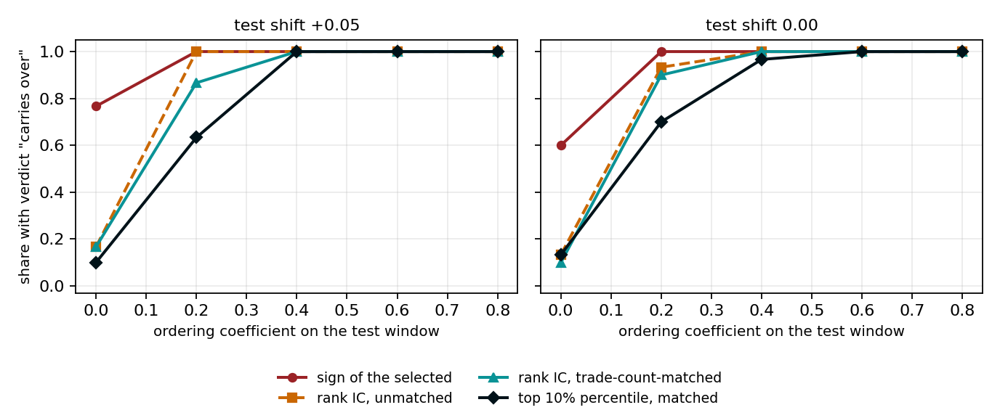

# The sign of the selected candidate's P&L conflates the level of the test period with the quality of selection

First public version, 11 October 2026.

SPP — Selection Procedure Portability: whether a selection rule's advantage carries over out of sample.

## Abstract

The standard walk-forward step reports the sign of the out-of-sample (OOS) P&L of a single candidate: the one the selection rule ranked first in-sample (IS). That sign conflates two facts: what kind of period the test period was for the whole candidate set, and whether the selected candidates' advantage survived. The familiar labels (non-robust, overfit, bad period) do not answer this question.

To make this visible, I build a simulation testbed in which the level of the period and the ordering among candidates are set in advance. On it one can see when the sign is wrong and the position of the selected top slice is not. Alongside it sits a comparison against candidates with the same number of trades: it removes the part of the level that passes through trade count, but it does not replace the P&L. Six windows of one trading system and six windows of another algorithm show the same reading on real history. How often the sign is wrong on other people's data is not estimated by these windows.

## 1. Question and contribution

The standard check works as follows. In-sample, the rule ranks one candidate first (sometimes five). On the next segment one looks at that candidate's P&L and its sign. On a strong segment almost any candidate gets a plus. On a weak segment almost none does. In both cases the ordering among candidates may survive, vanish, or flip, and the sign cannot tell these apart.

**Contribution.** The question this sign does not ask is whether the advantage of the selected candidates survived, or whether the plus and the minus belong to the period. The sign can be wrong, and is. On a strong period it can be positive with no ordering at all, and even when the ordering is flipped. On a weak period it can be negative while the ordering is intact. Not on every window: the share of pluses tracks the level. These cases are worked through after the testbed is described, with no claim about how often they occur in the market.

Non-robustness, overfitting, and a bad period do not close this question. The testbed exists to make the cases visible.

Reading the same step this way is useful in three places.

1. **Comparing selection rules.** Rules are compared on the same windows. Which of them puts candidates at the top that turn out above their set in the test is visible from sums and positions, not from prior faith in a formula.
2. **Any single window, profitable or losing.** It is read by the position of the selected candidate and of the selected top slice within that window's set. A single sum does not separate a period that moved everyone from a period in which specifically the selected ones sagged.
3. **A series of consecutive windows.** The same position is recorded window after window. While it jumps around, a single window is no reason to change the rule. A conclusion about the rule applies to the band in which the position has settled. No such series is assembled in this work; what to look at in it is described in Section 7.

**Relation to known procedures.** These methods answer different questions.

- Probability of backtest overfitting (PBO; Bailey, Borwein, López de Prado and Zhu) is the share of splits in which the candidate selected IS lands below the median OOS; it is computed via combinatorially symmetric cross-validation (CSCV).
- The deflated Sharpe ratio compares the best candidate's Sharpe ratio to a threshold that grows with the number of trials, and does not look at the next segment.
- The tests of White (2000) and Hansen (2005) ask whether the best of many rules beats a given benchmark by more than reuse of the same history would explain.

In Section 4.6, on the same splits, only the PBO indicator ("below median") and the sign ("in the red") are compared. The gap at equal trade count is a variant of a characteristic-matched benchmark (Daniel, Grinblatt, Titman and Wermers, 1997). Combinatorial purged cross-validation (CPCV) is not implemented in this work.

**Terminology.** Terms are standard where one exists. A *replicate* is one realization of the generator (one seed). The *testbed* is the simulation testbed. The *gap* is the excess of the top slice over a benchmark (top minus average). The *percentile* is the percentile rank. *Rank IC* is the Spearman rank correlation. The *decile sort* is the decile ladder. The *period level* is the common (market) component of a period. *Trade-count-matched* means benchmarked against characteristic-matched peers, here by number of trades (Daniel et al., 1997). The *effective number of clusters* is the inverse Herfindahl index of cluster shares. Three similar words are used strictly differently throughout.

"SPP" is the name of this reading. "Ordering preserved" is a property of a replicate on the testbed: the ordering coefficient on the test segment is positive. "Carries over" in testbed tables means the trade-count-matched percentile crosses its threshold. This is a count of the generator, in which the period level enters the P&L through trade count; it is not the name of a contribution.

## 2. Three quantities

SPP reads the test step through how the selected candidate or the selected top slice performed and through its position in the candidate set on the test. The trade-count-matched comparison is a side diagnostic. The "carries over / no verdict / inversion" threshold is a calibration of this testbed. It is not a rule for other people's history and not a definition of SPP.

A candidate is a rule that has, on each segment, a sum of the outcomes of its trades. On a segment the candidate set is ordered by this sum. All definitions refer to one step: the selection rule is declared IS, and the composition of the top slice is not revised on the test. Rank IC in this work is the Spearman coefficient, i.e. the correlation of ordinal ranks.

**Sign.** The OOS sum of the selected candidate (the one the selection rule ranked best IS). This is how the standard walk-forward step reads it. For top-5 it is the sign of the average sum of the five best.

**Percentile.** Candidates are ordered by OOS sum from worst to best. The percentile of the candidate at position $j$ in this order ($j=1$ is worst, $n$ is the set size):

```
percentile_j = 100 * (j - 1) / n
```

The worst has 0, the best has $100(n-1)/n$, i.e. just under 100. The percentile of a top slice is the median of its members' percentiles, not the percentile of their average sum. With ties in sums, candidates are ordered by row number, and the last of the tied is considered selected. In the library code the percentile is called `place`.

**Gap.** For a top slice $G$ of size $k$ (1, 5, 10 or 30% of the set; the main slice is 10%), the gap is the mean OOS sum of the top slice minus the expected mean of a random sample of the same size:

```
gap(G) = mean(test[G]) - E[mean(test[R])]
```

Here $R$ is a random sample of $k$ candidates without replacement. The expectation is computed exactly, with no random samples generated: under sampling without replacement the expected sample mean equals the set mean.

**Trade-count-matched gap.** A candidate's OOS sum depends on its number of trades: on a strong segment it grows with it, on a weak one it falls, if the period level passes into the P&L through entry frequency. The plain gap then rewards or punishes frequency. The trade-count-matched gap compares the top slice not with an arbitrary random sample but with a sample of the same size and the same composition across ten IS trade-count quantile bins. The expectation of such a sample is the bin means weighted by the number of top-slice members in each bin; it is computed exactly.

The trade-count-matched percentile is the candidate's percentile among candidates with a similar number of trades. For the selection rule "trade count", when the slice fills whole trade-count quantile bins (the main 10% slice with ten bins; likewise 30%), the matched gap is zero and the percentile is 50 by construction, up to ties in trade count. At 1% and 5% the slice is only part of the top bin, so zero and 50 are not identities. On this testbed such a row mutes the part of the level that passes through trade count. It does not replace the P&L of the selected. With a different level channel this no longer holds (4.12).

**Trade-count-matched rank IC.** Next to the sign and the position, one can read the rank IC between the IS score and the OOS sum within the same ten trade-count bins (the mean of Spearman coefficients weighted by bin size, `spearman_matched` in the library). On the testbed it separates ordering from level just as the matched percentile does (4.11). In reading a step on historical data it enters as the same side row.

**Selection rules and testbed scoring.** "Sum" and "average trade" (sum divided by number of trades). On historical windows "sum" is called Net (net profit), and PF (profit factor), low drawdown and trade count are added. The standard step keeps a candidate if the selected one's sum is positive. On the testbed, a triple is recorded separately from the matched percentile of the top 10%: "carries over" if it is at or above the upper threshold of null replicates, "inversion" if at or below the lower threshold, otherwise "no verdict" (thresholds in 4.1).

This triple tests the generator. On one's own window there is none: one reads the selected sum and the slice position. The trade-count-matched comparison stands alongside.

## 3. Testbed

A candidate trades a subset of a stream of 4,000 opportunities and skips the rest. A taken opportunity yields an outcome of +1 or −1, a skipped one 0. A candidate's sum is the sum of the outcomes of the trades it took. There are no costs, no leverage, and no reward-to-risk ratio: otherwise conventions about point value that have nothing to do with ordering transfer would enter the result.

There are 2,500 candidates, arranged in 50 clusters of 50 similar candidates. A trade-count base is assigned to the cluster, and each candidate adds noise to it. A candidate's trade count is the same on all segments (mean 447, SD 107 across candidates); only the outcomes change. All candidates take subsets of one stream of opportunities, and the outcome of a taken opportunity is shared by everyone who took it. A replicate is one realization of the generator, i.e. one seed.

**Period level and ordering.** The probability of a plus on a taken opportunity is a sigmoid of its latent quality. The latent quality on a segment equals the ordering coefficient times the common opportunity quality, plus noise, plus a shift; the noise width is chosen so that the variance of the quality-plus-noise terms is one. The common opportunity quality is the same on all segments and is normal noise.

A positive ordering coefficient preserves the advantage of those who IS took opportunities of high common quality; zero leaves noise; a negative one flips the ordering of candidates. The shift sets the level of the segment.

Level and ordering are not independent: candidate filters are on average positively related to common opportunity quality, so a positive coefficient at the same shift raises the set mean too. At shift +0.05 the set mean is +12 at zero coefficient and +108 at 0.8. In the configurations, level and ordering are separated by choosing the shift for each pair (Appendix A). A sketch of the two generator functions (constants in Appendix A, full code in `scripts/spp_catalog_six.py`):

```python
def latent(alpha, shift, edge, rng):
    if abs(alpha) >= 0.999:
        base = np.sign(alpha) * edge
    else:
        noise = rng.normal(0, 1, size=edge.shape)
        width = np.sqrt(max(0.0, 1.0 - alpha * alpha))
        base = alpha * edge + width * noise
    return base + shift

def build_mask(rng, edge):
    assign = np.repeat(np.arange(N_CLUSTERS), PER)
    exposure = np.clip(rng.normal(0.40, 0.16, size=N_CLUSTERS), 0.05, 0.85)
    residual = rng.normal(0, 1, size=(N_CLUSTERS, N_OPP))
    width = np.sqrt(np.clip(1 - exposure ** 2, 0.02, None))
    centers = exposure[:, None] * edge + width[:, None] * residual
    scores = centers[assign] + rng.normal(0, 0.22, size=(N_CLUSTERS * PER, N_OPP))
    # each candidate takes its trades by score; the mask is then frozen
```

**Calibration.** Shifts were tuned on seeds 41, 100, 7 and 19 so that the weak segment is not all zeros in share of pluses, and the flipped strong segment is not uniformly positive. The shift for the middle segment (0.00) is chosen so that the share in the black is about half, which is closer to the historical window 2/1 (59% in the black). Therefore all frequencies in the work are computed on other seeds (Appendix A). The dependence of the conclusion on three shifts is shown in Section 4.3; the +0.05 shift was not varied.

## 4. Results on the testbed

The testbed is built so that the answer is known before the tables. The period level and the ordering are set in advance, so on one and the same step one can see what the sign says and what the slice position says. Five such situations are in 4.2, the curve over level in 4.3, the decile ladder in 4.7. The "testbed score" column is the triple "carries over / no verdict / inversion" using the thresholds from 4.1. This is a check of the generator. When there is no ordering, the triple mostly says "no verdict"; this is not detection accuracy. In configuration 2 the ordering is alive and the top slice stays in the red (4.7): "carries over" there means the ordering was preserved, not that the system made money.

In the "correct out of 30" columns (4.4, 4.5, 4.8) a decision is correct if it matches the preset ordering: "keep" when the ordering is preserved, "stop" when there is no ordering and under inversion; "no verdict" counts as "stop". Shares are given as "k out of 30".

### 4.1 Null replicates

Here are the thresholds for the "testbed score" column. The five situations for which the testbed was built are in 4.2.

A null replicate is one in which the OOS ordering is unrelated to the IS ordering. There are two types of 200 replicates each: M (strong IS, middle OOS) and S (middle IS, strong OOS).

| Measure | Null type | Gap 10%, mean | Gap 10%, SD across replicates | Top-10% percentile: 5% / 50% / 95% | False "carries over" | False "inversion" |
|---|---|---:|---:|---:|---:|---:|
| plain | M | −0.4 | 7.5 | 26 / 49 / 73 | 4.5% | 9.5% |
| plain | S | +5.5 | 8.7 | 38 / 56 / 74 | 6.0% | 0.5% |
| trade-count-matched | M | −0.2 | 6.3 | 30 / 51 / 69 | 8.5% | 8.5% |
| trade-count-matched | S | +0.3 | 4.3 | 35 / 51 / 65 | 1.5% | 1.5% |

Observations.

1. The sign of the selected candidate is positive in 96 of 200 type-M replicates and in 200 of 200 type-S replicates. The sign follows the OOS level.
2. The plain gap is biased by level: the mean is +5.5 in type S versus −0.4 in type M. For the matched gap the means are +0.3 and −0.2, and the SD across replicates (both types together) falls from 8.7 to 5.4.
3. The SD of the gap across replicates is 5.8 times the SD within a replicate (10% slice; by type 6.6 for M and 4.7 for S, so the difference of type means does not inflate the ratio). The reason is not z itself but that a random sample of candidates does not preserve the cluster concentration of the top slice (4.9): the ratio is a symptom of this, not independent evidence. Hence the standardized gap within a single replicate, z, overstates confidence: |z| ≥ 5 in 39% of null replicates, and the 95th percentile of |z| is 11.6. The work does not use z.
4. The thresholds of the matched top-10% percentile are the 5% and 95% of the pooled null distribution of both types: 31 and 67. The verdict "carries over" is a percentile of at least 67, "inversion" at most 31, otherwise "no verdict". For the plain measure the thresholds are 30 and 74; for the rule "average trade" at equal trade count, 30 and 68.
5. Check on held-out null replicates not used to set the thresholds (seeds 8000–8199, 200 per type, 400 total): false "carries over" 22 of 400 (5.5%), false "inversion" 16 of 400 (4.0%); by type: M — 13 of 200 and 11 of 200, S — 9 of 200 and 5 of 200.
6. The threshold depends on the clustering of the top slice. The top 10% in type M occupy on average 9.7 clusters (effective number of clusters — the inverse Herfindahl index of cluster shares within the top slice — 6.3), in type S 21.6 (10.0). The SD of the matched gap is 6.3 and 4.3; the false verdict in each tail on null replicates is 8.5% and 1.5%. A common threshold is a compromise and does not transfer to a set with different clustering (measured in 4.9).
7. The matched gap in units of the SD of the OOS set: the 5% and 95% of the null for both types are −0.43 and +0.41 (type M: −0.51 and +0.53, type S: −0.20 and +0.22). A deviation of more than 0.3 SD in absolute value occurs in 20% of null replicates (M 37%, S 4%, held-out 21%).
8. The percentile of the selected candidate in null replicates ranges from 8 to 96 (5–95%) and is at least 87 in 18% of replicates; for a random candidate such a percentile occurs in 13% of cases.

### 4.2 Five configurations

Five IS → OOS pairs, 30 replicates each. The input is the same: the rule "sum" freezes the top 10% IS. On the test, the sign of the selected and the position of this slice stand side by side. The percentile of the selected is plain. The slice position and gap are trade-count-matched. The testbed score is the same triple.

| Configuration | OOS set: mean sum / in the black | Sign of selected "+" | Percentile of selected (plain) | Percentile of top 10% | Gap 10% (sum units) | Testbed score: carries over / no verdict / inversion |
|---|---:|---:|---:|---:|---:|---:|
| Strong after strong, ordering preserved | +111.1 / 99% | 30/30 | 98 | 85 | +53.0 | 30 / 0 / 0 |
| Weak after strong, ordering preserved | −63.5 / 8% | 15/30 | 85 | 85 | +50.4 | 30 / 0 / 0 |
| Ordering inversion (weak → strong) | +55.5 / 89% | 10/30 | 8 | 12 | −46.6 | 0 / 0 / 30 |
| No ordering, middle OOS | +1.6 / 52% | 14/30 | 49 | 48 | −0.4 | 4 / 23 / 3 |
| No ordering, strong OOS | +110.1 / 100% | 30/30 | 67 | 50 | +0.4 | 1 / 28 / 1 |

1. **Strong period, ordering preserved.** 99% of candidates are in the black. The sign is positive in 30 of 30 replicates and could not be wrong here: almost everyone has a plus. The position of the top 10% is also high (85). The sign and the position point the same way. This is the control.
2. **Weak period, ordering preserved.** Only 8% of candidates are in the black, the set mean is −63.5. The sign of the selected is positive in 15 of 30 replicates: on this window it is a coin flip. In the remaining replicates the sign would have shut down a selection whose ordering is alive. The position of the top 10% is nevertheless 85, and the testbed score is "carries over" in 30 of 30. This does not promise money: the top 10% earn −25.0, with 29% of the group in the black (4.7). The ordering is alive, the sum is in the red.
3. **Ordering flipped.** The OOS set is in the black (+55.5, 89%). The sign of the selected is positive in 10 of 30 replicates: in them the sign would have kept a flipped selection. The position of the selected is on average 8, of the top 10% 12, the gap −46.6. The slice sits at the bottom of the set. The testbed score is "inversion" in 30 of 30.
4. **No ordering, middle period.** The sign is positive in 14 of 30 replicates, the slice position is 48, near the middle. Testbed score: carries over 4 of 30, no verdict 23 of 30, inversion 3 of 30. The method mostly stays silent.
5. **No ordering, strong period.** The whole set is in the black (+110.1, 100%). The sign is positive in 30 of 30 replicates: everyone has a plus, and the sign cannot distinguish it from a genuine selection effect. The position of the top 10% is 50, the gap +0.4. Testbed score: carries over 1 of 30, no verdict 28 of 30, inversion 1 of 30. Almost all replicates are "no verdict".

One step of the same ribbon, by name, is worked through in 4.10. On history the same divergence of sign and slice is window 1/3 in Section 5. The sign of the mean sum of the top 5 behaves like the sign of the single selected: 30 of 30, 14 of 30, 11 of 30, 16 of 30, 30 of 30.

### 4.3 Dependence on period level

The error rate of the sign depends on how strong or weak the test segment is, so it is shown as a function of level. The asterisk is the value adopted in the configurations. Rows with an asterisk repeat the parameters of Section 4.2 on other seeds (20000–20029). Differences between the seed sets are the spread of 30 replicates: sign "+" under inversion 10 of 30 in 4.2 and 9 of 30 here (19 of 60 together), at a weak segment 15 of 30 and 16 of 30 (31 of 60 together). The "plain" and "trade-count-matched" columns are the number of replicates with the verdicts "carries over" and "inversion".

Ordering inversion, OOS shift:

| OOS shift | Set: mean sum / in the black | Sign of selected "+" | Plain: carries over / inversion | Matched: carries over / inversion |
|---|---|---:|---:|---:|
| +0.35 | −25 / 28% | 0/30 | 0 / 30 | 0 / 30 |
| +0.55 | +14 / 62% | 1/30 | 0 / 30 | 0 / 30 |
| +0.75* | +53 / 89% | 9/30 | 0 / 30 | 0 / 30 |
| +0.95 | +90 / 98% | 17/30 | 0 / 30 | 0 / 30 |
| +1.15 | +127 / 100% | 27/30 | 0 / 30 | 0 / 30 |

Weak after strong, ordering preserved, OOS shift:

| OOS shift | Set: mean sum / in the black | Sign of selected "+" | Plain: carries over / inversion | Matched: carries over / inversion |
|---|---|---:|---:|---:|
| −0.45 | +14 / 61% | 30/30 | 30 / 0 | 30 / 0 |
| −0.65 | −24 / 31% | 29/30 | 30 / 0 | 30 / 0 |
| −0.85* | −62 / 10% | 16/30 | 26 / 0 | 30 / 0 |
| −1.05 | −100 / 2% | 1/30 | 17 / 0 | 30 / 0 |
| −1.25 | −136 / 0% | 0/30 | 9 / 0 | 30 / 0 |

No ordering, middle OOS, OOS shift:

| OOS shift | Set: mean sum / in the black | Sign of selected "+" | Plain: carries over / inversion | Matched: carries over / inversion |
|---|---|---:|---:|---:|
| −0.40 | −76 / 0% | 0/30 | 0 / 11 | 2 / 0 |
| −0.20 | −39 / 3% | 0/30 | 0 / 6 | 3 / 0 |
| +0.00* | −1 / 48% | 13/30 | 3 / 1 | 3 / 0 |
| +0.20 | +37 / 96% | 30/30 | 8 / 0 | 3 / 1 |
| +0.40 | +74 / 100% | 30/30 | 12 / 0 | 3 / 1 |

Under inversion the sign "+" occurs in 0 of 30 replicates at shift +0.35, in 9 of 30 at the adopted +0.75 and in 27 of 30 at +1.15; the verdict "inversion" is correct in all. On a weak segment with preserved ordering the sign "+" stands in 30 of 30 replicates at −0.45, in 16 of 30 at the adopted −0.85 and in 0 of 30 at −1.25.

The plain measure loses power on the weak segment: "carries over" in 9 of 30 replicates at −1.25, whereas the matched one gives 30 of 30. When the IS has ordering and the OOS has none and is strong (shift +0.4), the plain measure gives a false "carries over" in 12 of 30 replicates, the matched one in 3 of 30, and the sign "+" stands in 30 of 30.

Two more sweeps are not in the tables. OOS without ordering after IS without ordering, at shifts from +0.30 to +0.90: the sign "+" in at least 29 of 30 replicates, a false matched "carries over" in at most 1 of 30. IS shift under inversion from −0.45 to −1.25: the verdict "inversion" in at least 30 of 30, the sign "+" in at most 11 of 30.


Figure 1. The vertical axis is the share of replicates in which the reading matched the preset ordering. For the sign it collapses at the extremes of level. The matched score holds on these curves as long as the level passes through trade count, and breaks down with a second channel (4.12).

All sweep rows are computed on the same seeds 20000–20029, so equal values in adjacent rows are largely the same replicates, not independent confirmations.

"The sign is wrong in so many replicates" without a period level is a point on this curve, not a frequency in the market.

### 4.4 Sensitivity to ordering

IS: ordering coefficient 1.00. The OOS ordering coefficient varies; thresholds as in 4.1. The OOS shift +0.05 or 0.00 sets the level at zero coefficient (set mean sum and share in the black are given in the table); as the coefficient grows the level grows too, so the sign "+" column follows level, not just ordering.

| OOS shift | OOS ordering coefficient | Set: mean sum / in the black | Rank IC of average trade | Sign of selected "+" | "Carries over": "sum", plain | "Carries over": "sum", matched | "Carries over": "average trade", matched | Correct of 30: sign / SPP "sum", matched |
|---|---:|---:|---:|---:|---:|---:|---:|---:|
| shift +0.05 | 0.0 | +12 / 72% | +0.04 | 23/30 | 4/30 | 3/30 | 1/30 | 7 / 27 |
| shift +0.05 | 0.2 | +36 / 93% | +0.41 | 30/30 | 25/30 | 19/30 | 24/30 | 30 / 19 |
| shift +0.05 | 0.4 | +60 / 98% | +0.64 | 30/30 | 30/30 | 30/30 | 29/30 | 30 / 30 |
| shift +0.05 | 0.6 | +85 / 99% | +0.76 | 30/30 | 30/30 | 30/30 | 30/30 | 30 / 30 |
| shift +0.05 | 0.8 | +108 / 99% | +0.82 | 30/30 | 30/30 | 30/30 | 30/30 | 30 / 30 |
| shift 0.00 | 0.0 | +3 / 56% | +0.04 | 18/30 | 2/30 | 4/30 | 3/30 | 12 / 26 |
| shift 0.00 | 0.2 | +27 / 87% | +0.40 | 30/30 | 23/30 | 21/30 | 22/30 | 30 / 21 |
| shift 0.00 | 0.4 | +51 / 96% | +0.63 | 30/30 | 30/30 | 29/30 | 29/30 | 30 / 29 |
| shift 0.00 | 0.6 | +76 / 98% | +0.76 | 30/30 | 30/30 | 30/30 | 30/30 | 30 / 30 |
| shift 0.00 | 0.8 | +99 / 99% | +0.82 | 30/30 | 30/30 | 30/30 | 30/30 | 30 / 30 |

At coefficient 0.2 (rank IC of average trade +0.41) the verdict "carries over" is given in 19 of 30 replicates at shift +0.05 and in 21 of 30 at 0.00. At 0.4 (IC +0.64) in 30 of 30 and 29 of 30. At zero the false "carries over" is 3 of 30 and 4 of 30.

At coefficient 0.2 the plain measure sees carry-over in 25 of 30 and 23 of 30 replicates, at zero in 4 of 30 and 2 of 30. So matching costs part of the power at weak ordering and buys independence from level. The method does not always see weak ordering, and the price of a miss is a forgone system with preserved ordering.

At coefficient 0.2 the sign "+" stands in 30 of 30 replicates at both shifts: 93% and 87% of candidates are already in the black, and a sign error cannot be seen on such a strong period. The matched score flags ordering in 19 of 30 and 21 of 30 replicates. This is the testbed's power at weak ordering.



Figure 2. At zero ordering coefficient the sign's "carries over" is determined by level, the other measures' is not; at 0.2 SPP's power is lower than rank IC's.

Position of historical windows on this scale. Rank IC "same metric → same metric" on historical windows is no higher than +0.30 (Appendix B). On the testbed with 50 clusters an IC of that size corresponds to an ordering coefficient no higher than 0.2 (with few clusters the conversion is not guaranteed, 4.9). At such a coefficient carry-over is visible in only 19 of 30 (shift +0.05) and 21 of 30 (shift 0.00) replicates.

The matched gap in units of the set SD: the null (5–95%) from −0.43 to +0.41, at ordering coefficient 0.2 on average +0.65, configuration 2 +1.08, inversion −1.09; on historical windows from −0.92 to +0.56. Configurations 2 and 3 show the sign's failure at strong ordering. SPP's sensitivity to weak ordering is measured only here.

### 4.5 Chains of six segments

A chain is six segments of one history: strong, strong, weak, strong with inverted ordering, middle, strong. The rolling rule learns on the previous segment. 30 chains were taken (seeds 4000–4029).

| Step | OOS segment | Ordering coefficient | Ordering preserved | Sign of selected "+" | Percentile of selected (plain) | Percentile of top 10% | Gap 10% (sum units) | Verdict: carries over / no verdict / inversion | Correct of 30: sign / SPP "sum" / SPP "average trade" |
|---|---|---:|---|---:|---:|---:|---:|---:|---:|
| 1→2 | strong | +0.82 | yes | 30/30 | 96 | 87 | +57.3 | 30 / 0 / 0 | 30 / 30 / 30 |
| 2→3 | weak | +0.78 | yes | 12/30 | 85 | 85 | +51.2 | 30 / 0 / 0 | 12 / 30 / 30 |
| 3→4 | strong, inversion | −0.72 | no | 3/30 | 5 | 13 | −46.3 | 0 / 1 / 29 | 27 / 30 / 30 |
| 4→5 | middle | 0.00 | no | 14/30 | 47 | 50 | +0.9 | 3 / 25 / 2 | 16 / 27 / 28 |
| 5→6 | strong | 0.00 | no | 30/30 | 56 | 48 | −0.6 | 0 / 30 / 0 | 0 / 30 / 29 |

Per chain there are on average 2.97 pluses out of five steps; four or more in 6 of 30 chains. Of 89 positive steps, 47 (53%) stand where there is no ordering or it is inverted. Every chain has at least 1 such plus, on average 1.57 of the three steps without ordering. A report of "a plus on most steps" would be taken as a sign of a working procedure, although in these chains 53% of the pluses sit on steps without ordering. This share is set by the composition of the chain (three steps of five without ordering or with inversion) and does not estimate how often this happens.

At step 5→6 the sign "+" stands in 30 of 30 chains, with 0 of 30 correct decisions by sign and 30 of 30 by SPP. At the inversion 3→4 the sign "+" is in only 3 of 30 chains, with the percentile of the selected averaging 5.

### 4.6 Combinatorial splits

The same chains are cut in two ways: one segment as test and five as training (6 splits), and three versus three (all 20 combinations of three; mutually complementary pairs give two splits). This is a full enumeration of one chain, not independent histories. "Selected below median" means its OOS percentile is below 50 (this is how the PBO indicator is computed). The percentile and gap of the top slice are trade-count-matched.

| Test segment | Type | Selected below median | Selected in the red | Top-slice gap < 0 | Percentile of selected (plain) | Percentile of top slice |
|---|---|---:|---:|---:|---:|---:|
| 1 | strong | 0/30 | 0/30 | 0/30 | 93 | 80 |
| 2 | strong | 0/30 | 0/30 | 0/30 | 90 | 80 |
| 3 | weak | 7/30 | 24/30 | 0/30 | 69 | 77 |
| 4 | strong, inversion | 29/30 | 22/30 | 30/30 | 12 | 12 |
| 5 | middle | 17/30 | 15/30 | 18/30 | 45 | 50 |
| 6 | strong | 6/30 | 0/30 | 13/30 | 72 | 50 |

The top-slice gap is negative: on segments 1–3 (ordering preserved) in 0 of 30 chains each; on segment 4 (inversion) in 30 of 30; on segments 5 and 6 (no ordering) in 18 of 30 and 13 of 30. The "below median" indicator is distorted by trade frequency. On segment 6 there is no ordering, yet the indicator fires in only 6 of 30 instead of roughly half: frequency lifts the selected's percentile to 72, while the top slice at equal trade count stands at 50. On the weak segment 3 the ordering is preserved, yet the indicator fires in 7 of 30.

The share of splits below median, by chain: for one segment 0.33 with an SD of 0.17 across chains (from 0.00 to 0.67), for triples 0.26 with an SD of 0.14 (from 0.00 to 0.55). An estimate from a single chain, with the world's structure unchanged, is scattered from zero to 0.67. The share "in the red" (probability of loss) on triples is 0.07, the share of splits with negative top-slice gap 0.24.

The indicator and the sign of the top-slice gap agreed in 148 of 180 splits (82%) for one segment and in 500 of 600 (83%) for triples. The top slice refines the indicator where frequency affects it. The sign of the selected ("in the red") and the sign of the top-slice gap agreed in 120 of 180 (67%) and 463 of 600 (77%) splits, i.e. they diverge more often than the indicator and the gap do.

### 4.7 Decile ladder and the fork between rules

The ladder is the mean OOS sum across ten slices of the set ordered by the IS score "sum" (slice 1 is the IS top). Mean over 30 replicates per configuration (seeds 1000–1029, the same replicates as 4.2). The 10% slice compresses this picture into one number; here it is seen in full.

| Configuration | Set | Slice 1 (top) | Slice 2 | Slice 3 | Slice 4 | Slice 5 | Slice 6 | Slice 7 | Slice 8 | Slice 9 | Slice 10 (bottom) |
|---|---:|---:|---:|---:|---:|---:|---:|---:|---:|---:|---:|
| Strong after strong, ordering preserved | +111 | +188 | +157 | +138 | +124 | +113 | +102 | +92 | +82 | +68 | +47 |
| Weak after strong, ordering preserved | −63 | −25 | −42 | −49 | −53 | −58 | −64 | −70 | −75 | −90 | −109 |
| Ordering inversion (weak → strong) | +56 | −1 | +18 | +30 | +39 | +48 | +57 | +69 | +80 | +93 | +122 |
| No ordering, middle OOS | +2 | +1 | +3 | +1 | +1 | +2 | +2 | +2 | +2 | +1 | +1 |
| No ordering, strong OOS | +110 | +114 | +110 | +109 | +109 | +109 | +108 | +108 | +109 | +111 | +114 |

Under inversion the ladder rises toward the bottom of the IS ranking: −1 for the top slice and +122 for the bottom, with a set mean of +55.5. On a weak segment with preserved ordering it declines from −25 to −109: the ordering is alive, but the top slice also stays in the red, i.e. the sign does not show this. On a strong segment with preserved ordering it declines from +188 to +47. Without ordering the ladder is flat: a range between slices of 2 on the middle segment and 6 on the strong one, with set mean sums of +1.6 and +110.1. This is the mean over replicates; in a single replicate the ladder is noisier (example in 4.10).

The rules "sum" and "average trade" select groups of different frequency; this is visible on the weak segment.

| Configuration | Rule | Trades of top 10% (set mean 463) | Mean OOS sum of top 10% | In the black | Matched percentile |
|---|---|---:|---:|---:|---:|
| Strong after strong, ordering preserved | sum | 558 | +188.1 | 100% | 85 |
| Strong after strong, ordering preserved | average trade | 419 | +159.0 | 100% | 87 |
| Weak after strong, ordering preserved | sum | 558 | −25.0 | 29% | 85 |
| Weak after strong, ordering preserved | average trade | 419 | +1.2 | 52% | 88 |
| Ordering inversion (weak → strong) | sum | 438 | −0.7 | 45% | 12 |
| Ordering inversion (weak → strong) | average trade | 413 | −1.7 | 44% | 13 |

On a weak segment with preserved ordering (configuration 2), the top 10% by sum have on average 558 trades against 463 for the set; in the test they yield −25.0, with 29% of the group's candidates in the black. The top 10% by average trade have 419 trades, yield +1.2, with 52% in the black. The matched percentile of both rules is almost identical (85 and 88): matching removes exactly this difference, which remains in the sum and the sign.

On a strong segment (configuration 1) frequency works the other way: +188.1 for the rule "sum" against +159.0 for "average trade". The correlation of trade count and sum is −0.43 on the weak segment (configuration 2) and +0.41 on the strong one (configuration 1), mean over 30 replicates. Under inversion both rules give about zero (−0.7 and −1.7) at percentiles 12 and 13.

### 4.8 Size of the top group

The main slice is the top 10%. Here is the same reading at 1, 5, 10 and 30% of the set (rule "sum", trade-count-matched). Thresholds for each slice are its own: the 5% and 95% of the null distribution of the same null replicates (seeds 2000–2199); false verdicts are on 400 held-out null replicates. A cell is the number of replicates with verdicts "carries over" / "inversion" and the number of correct decisions out of 30.

| Configuration | 1%: carries over / inversion / correct | 5%: carries over / inversion / correct | 10%: carries over / inversion / correct | 30%: carries over / inversion / correct |
|---|---:|---:|---:|---:|
| Strong after strong, ordering preserved | 28 / 0 / 28 | 29 / 0 / 29 | 30 / 0 / 30 | 30 / 0 / 30 |
| Weak after strong, ordering preserved | 29 / 0 / 29 | 30 / 0 / 30 | 30 / 0 / 30 | 30 / 0 / 30 |
| Ordering inversion (weak → strong) | 0 / 24 / 30 | 0 / 30 / 30 | 0 / 30 / 30 | 0 / 30 / 30 |
| No ordering, middle OOS | 3 / 1 / 27 | 2 / 4 / 28 | 4 / 3 / 26 | 5 / 3 / 25 |
| No ordering, strong OOS | 3 / 1 / 27 | 3 / 1 / 27 | 1 / 1 / 29 | 0 / 0 / 30 |
| Thresholds (lower / upper) | 17 / 84 | 28 / 74 | 31 / 67 | 40 / 60 |
| Held-out nulls: false "carries over" / "inversion" | 19 / 26 | 22 / 27 | 22 / 16 | 21 / 28 |

The number of correct decisions is at least 25 of 30 for any of the four slice sizes in any configuration; the smallest is configuration 4 at 30% (25 of 30). In configuration 3, "no verdict" is counted as correct, so separately: the verdict "inversion" stands in 24 of 30 replicates at 1% and in 30 of 30 at 5, 10 and 30%; correct decisions are 30 of 30 at each of the four sizes. The false verdict on held-out null replicates does not exceed 7.0% at any slice size (the threshold was designed for 5%; the standard error on 400 replicates is about 1.1 points). So the choice of 10% does not determine the reading on the testbed. This is a check on one generator: for historical windows, slices of 1, 10 and 30% in Section 5 are given without thresholds.

### 4.9 Number of clusters

What follows is not a second contribution. It is the answer to why the testbed-score threshold cannot be carried to another set. First it is shown that a threshold tuned at 50 clusters does not transfer to a different number of clusters. Then (4.13) a null that preserves clusters shows that it was the null that broke, not the reading of the step. There are no cluster labels on historical sets, so the threshold stays on the testbed.

There are always 2,500 candidates; only the partition changes: K clusters of 2,500 / K similar candidates, the rest as in Section 3. Null replicates of type M (100 per K, seeds 9000–9099) and replicates with OOS ordering (coefficient 0.4, OOS shift 0.00; 30 per K, seeds 9500–9529). The threshold everywhere is the one tuned for K = 50 in 4.1. The K = 50 row is another seed set and type M only: in 4.1 for type M on held-out replicates the false "carries over" and false "inversion" are 13 of 200 and 11 of 200; the row agrees with them within sampling spread.

| Clusters K | Candidates per cluster | Clusters in top 10% | Effective clusters | SD of gap (set-SD units) | Top-10% percentile: 5% / 50% / 95% | False "carries over" / "inversion" at the K = 50 threshold |
|---:|---:|---:|---:|---:|---:|---:|
| 2 | 1250 | 1.2 | 1.0 | 0.20 | 33 / 49 / 61 | 2% / 5% |
| 5 | 500 | 1.6 | 1.2 | 0.34 | 24 / 50 / 70 | 10% / 8% |
| 10 | 250 | 2.5 | 1.5 | 0.52 | 23 / 48 / 76 | 16% / 18% |
| 25 | 100 | 5.5 | 3.2 | 0.40 | 25 / 47 / 72 | 8% / 16% |
| 50 | 50 | 9.3 | 6.2 | 0.31 | 31 / 51 / 69 | 7% / 5% |
| 125 | 20 | 21.0 | 15.0 | 0.28 | 32 / 50 / 68 | 6% / 3% |
| 500 | 5 | 68.1 | 57.5 | 0.24 | 37 / 49 / 65 | 4% / 2% |

1. The number of independent chances in the top slice is not the number of candidates. At K = 500 the top 10% occupy on average 57.5 effective clusters, at K = 50 6.2, at K = 10 1.5, at K = 2 1.0.
2. The null distribution is wider at small K: the SD of the gap is 0.24 set SD at K = 500, 0.31 at 50 and 0.52 at 10. Below K = 10 the SD falls again (0.34 at K = 5, 0.20 at K = 2): there the top 10% lie almost entirely in one or two clusters. The dependence is non-monotonic; the cause is checked in 4.12: on this testbed trade count is assigned to the cluster, and matching on it absorbs the between-cluster part of the signal.
3. The threshold tuned for K = 50 gives a false "carries over" from 2% to 16% across K (4% at K = 500, 16% at K = 10, 2% at K = 2) and a false "inversion" up to 18% at K = 10. It does not transfer to a set with a different number of clusters; in 4.1 this was a caveat, here it is measured.

| Clusters K | Rank IC of average trade: across candidates | On cluster means | "Carries over" at the K = 50 threshold | Sign of selected "+" |
|---:|---:|---:|---:|---:|
| 2 | +0.14 | — | 2/30 | 30/30 |
| 5 | +0.48 | +0.54 | 9/30 | 30/30 |
| 10 | +0.60 | +0.66 | 19/30 | 30/30 |
| 25 | +0.65 | +0.69 | 24/30 | 30/30 |
| 50 | +0.66 | +0.72 | 29/30 | 30/30 |
| 125 | +0.65 | +0.70 | 30/30 | 30/30 |
| 500 | +0.64 | +0.69 | 30/30 | 30/30 |

One and the same ordering coefficient of 0.4 appears as a rank IC of average trade across candidates of +0.14 at K = 2, +0.48 at 5, +0.60 at 10 and +0.66 at 50; on cluster means at K ≥ 5 it lies between +0.54 and +0.72. The verdict "carries over" at the K = 50 threshold: 2 of 30 at K = 2, 9 of 30 at 5, 19 of 30 at 10 and 29 of 30 at 50. Three consequences follow.

- The label for the strength of an association ("weak", "strong") across candidates depends on the number of clusters.
- The conversion of the historical windows' IC (no higher than +0.30) into an ordering coefficient no higher than 0.2 (4.4) holds at K ≥ 10. At K = 2 a coefficient of 0.4 gives an IC of +0.14, at K = 5 +0.48, so for a set with few clusters this conversion is not guaranteed, and the number of clusters of historical sets is unknown.
- Power at coefficient 0.4 and a fixed threshold falls as K decreases, but this is partly the width of the null given the tie of trade count to the cluster (4.12). The curve over ordering coefficient (4.4) was not built for other K.

Limit of the experiment. Here the partition of the world changes, not the sampling scheme; the null that selects whole clusters is in 4.13. Clusters are of equal size; for historical sets sizes and boundaries are unknown.

### 4.10 Illustration: one chain

Seed 41 took part in tuning the shifts, so it serves as an illustration, not a check. The selected candidate's sums by step are +168, −102, +3, +2, +152, i.e. 4 pluses of five; this is the upper tail of the distribution from 4.5.

| Step | OOS segment | Selected: sum | Percentile of selected | Top-10% percentile (matched) | Gap 10% (sum units) | Set: mean sum |
|---|---|---:|---:|---:|---:|---:|
| 1→2 | strong | +168 | 96 | 83 | +39 | +105 |
| 2→3 | weak | −102 | 19 | 85 | +42 | −62 |
| 3→4 | strong, inversion | +3 | 6 | 10 | −37 | +57 |
| 4→5 | middle | +2 | 49 | 28 | −13 | +3 |
| 5→6 | strong | +152 | 90 | 48 | −1 | +110 |

At step 3→4 (inversion) the sign is positive (+3) with the selected's percentile at 6 and the top 10% at 10: the top IS decile ends the test with a sum of +3, the bottom with +126. Over 30 chains the sign "+" at this step appears in only 3 of 30, so the example is atypical in sign. At step 5→6 the plus (+152) stands at percentile 90, while the top 10% are at 48: the plus is explained by frequency. The value 28 at step 4→5 is an ordinary null event (4.1).

### 4.11 Decomposition: what carries the result

The method consists of two operations: matching on trade count, and reading the step through the lift of the top slice. The question: which of them carries the result, and can the step be read differently? On the same replicates, seeds and with the same threshold protocol (5% and 95% of null replicates of both types; the second variant, type M only) the following were read:

- rank IC across the whole set and trade-count-matched (within ten trade-count bins);
- the share of common names in the top 10% of IS and OOS;
- the difference in mean OOS between the top and bottom IS decile in set SD;
- the matched gap in set SD;
- the "below median" indicator.

The SPP and sign columns are taken from the runs of 4.1–4.8 without recomputation. There are no new seeds, so this is a decomposition on the same replicates, not an independent check.

False verdicts on held-out null replicates: "carries over" / "inversion" out of 200 per type. For the sign and the indicator there is no threshold; the share "keep" is given.

| Measure | Threshold: lower / upper | Thresholds of both types: type M, "carries over" / "inversion" | Thresholds of both types: type S | Type-M thresholds: type M | Type-M thresholds: type S |
|---|---:|---:|---:|---:|---:|
| SPP: top-10% percentile | 31 / 67 | 13 / 11 | 9 / 5 | 12 / 10 | 6 / 5 |
| SPP: top-10% gap, SD | −0.43 / +0.41 | 22 / 23 | 0 / 1 | 10 / 10 | 0 / 0 |
| Spearman across the set | −0.26 / +0.24 | 9 / 10 | 8 / 6 | 9 / 7 | 7 / 4 |
| Spearman within trade-count bins | −0.20 / +0.22 | 13 / 17 | 2 / 8 | 10 / 9 | 1 / 1 |
| Top-10% overlap | +0.01 / +0.26 | 13 / 16 | 15 / 2 | 13 / 8 | 12 / 0 |
| Top minus bottom decile | −0.98 / +0.96 | 11 / 9 | 5 / 3 | 7 / 4 | 2 / 3 |
| Sign of selected "+" | — | 91 of 200 | 200 of 200 | — | — |
| Selected at or above median (PBO indicator) | — | 95 of 200 | 145 of 200 | — | — |

Number of "carries over" verdicts (for the sign and the indicator, "keep") out of 30; thresholds of both types. "Carries over" is correct in configurations 1 and 2 and at α > 0; in configurations 3, 4, 5 and at α = 0 there is no ordering or it is inverted.

| Measure | Conf. 1 | Conf. 2 | Conf. 3 | Conf. 4 | Conf. 5 | α = 0.2 (shift +0.05) | α = 0.2 (shift 0.00) | α = 0.4 (shift 0.00) |
|---|---:|---:|---:|---:|---:|---:|---:|---:|
| SPP: top-10% percentile | 30 | 30 | 0 | 4 | 1 | 19 | 21 | 29 |
| SPP: top-10% gap, SD | 30 | 30 | 0 | 5 | 0 | 23 | 24 | 30 |
| Spearman across the set | 30 | 29 | 0 | 7 | 1 | 30 | 28 | 30 |
| Spearman within trade-count bins | 30 | 30 | 0 | 3 | 0 | 26 | 27 | 30 |
| Top-10% overlap | 30 | 16 | 0 | 2 | 3 | 25 | 24 | 30 |
| Top minus bottom decile | 30 | 29 | 0 | 4 | 0 | 28 | 27 | 30 |
| Sign of selected "+" | 30 | 15 | 10 | 14 | 30 | 30 | 30 | 30 |
| Selected at or above median (PBO indicator) | 30 | 29 | 0 | 14 | 23 | 29 | 28 | 30 |

The same on the level sweeps (4.3; seeds 20000–20029): "weak" means ordering preserved, "no ordering" means no ordering.

| Measure | weak −0.85 | weak −1.25 | no ordering 0.00 | no ordering +0.20 | no ordering +0.40 |
|---|---:|---:|---:|---:|---:|
| SPP: top-10% percentile | 30 | 30 | 3 | 3 | 3 |
| SPP: top-10% gap, SD | 30 | 30 | 6 | 2 | 1 |
| Spearman across the set | 30 | 18 | 1 | 8 | 17 |
| Spearman within trade-count bins | 30 | 30 | 1 | 3 | 0 |
| Top-10% overlap | 22 | 10 | 4 | 6 | 8 |
| Top minus bottom decile | 30 | 25 | 3 | 6 | 12 |
| Sign of selected "+" | 16 | 0 | 13 | 30 | 30 |
| Selected at or above median (PBO indicator) | 30 | 26 | 13 | 20 | 23 |

Three states of ordering instead of two (configurations 1–5, thresholds of both types): ordering present, no ordering, inversion.

| State of ordering | Replicates | SPP (top-10% percentile): carries over / no verdict / inversion | Spearman within bins: carries over / no verdict / inversion |
|---|---:|---:|---:|
| Ordering present (configurations 1 and 2) | 60 | 60 / 0 / 0 | 60 / 0 / 0 |
| No ordering (configurations 4 and 5) | 60 | 5 / 51 / 4 | 3 / 54 / 3 |
| Inversion (configuration 3) | 30 | 0 / 0 / 30 | 0 / 0 / 30 |

1. **On this testbed, invariance to level comes from matching on trade count.** Rank IC without matching depends on level just like the plain gap: on the weakest segment (−1.25) it sees carry-over in 18 of 30 replicates (slice percentile: 30 of 30), and with OOS without ordering at shift +0.40 it gives a false "carries over" in 17 of 30 (slice percentile: 3 of 30). Spearman within trade-count bins holds up the same way: 30 of 30 and 0 of 30. The choice between slice percentile and this IC is not a contribution.
2. **The top slice and the matched rank IC read the same thing on this testbed.** False "carries over" on held-out null replicates: 15 of 400 against 22 of 400 for SPP. At ordering coefficient 0.2, "carries over" is seen in 26 of 30 and 27 of 30 replicates against 19 of 30 and 21 of 30; Spearman across the set is more powerful (30 of 30 and 28 of 30) but loses on the weak segment. In configurations 1–3 the results coincide. Ordering on the testbed is common to the whole set, so a whole-set measure and a top-slice measure differ little; a set in which ordering is preserved only at the top was not modeled.
3. **The "below median" indicator and the sign.** The indicator is distorted by frequency just like the sign: with no ordering it says "keep" in 14 of 30 and 23 of 30 replicates of configurations 4 and 5. The sign: in 14 of 30 and 30 of 30.
4. **Type of null.** Null M (ordering existed IS, vanished OOS) is what the practitioner fears most. For it the false "carries over" of SPP on held-out replicates is 13 of 200 at the common threshold and 12 of 200 at the threshold tuned on type M alone. The nominal 5% is not reached even with a threshold tuned on M itself, so the cause is not only the mixture of null types in the common threshold (on type S the same thresholds give 6 of 200 and 9 of 200). For Spearman within bins: 13 of 200 and 10 of 200. The excess over 5% on 200 replicates is about one standard error (1.7 points), i.e. 5% cannot be distinguished from 6–7% at this number of replicates.
5. **"No verdict" and the count of correct decisions.** In replicates with known state of ordering, SPP gives a definite verdict (carries over or inversion) in 99 of 150 (66%), of which 90 (91%) are correct. When there is no ordering, "no verdict" in 51 of 60, false "carries over" in 5 of 60, false "inversion" in 4 of 60. The count of "correct decisions" (4.4, 4.5, 4.8) counts "no verdict" as a correct "stop"; here it is broken down. For Spearman within bins coverage is 64% and accuracy among definite verdicts 94%.

Limit of the experiment: one generator, the same replicates. The number of clusters was not varied for the other measures here (4.12 and 4.13 do this). All measures read one step.

### 4.12 What is built into the generator

Two features of the testbed worked in the method's favor: the level acts on the sum only through trade count, and trade count is assigned to the cluster, not the candidate. Both are checked on generator variants (`spp_catalog_seven.py`; at default values the replicates coincide bit for bit with the main generator). Numbers are given at the base testbed's thresholds. Matching everywhere is on IS trade count, as on historical windows.

**A second level channel.** Each candidate is given a sensitivity to the level shift $\beta_i = 1 + s\,u_i$ ($u_i$ uniform from −1 to 1, independent of trade count); the probability of a plus is taken from the latent quality plus $\beta_i\cdot$shift. The outcome of a taken opportunity is still shared by everyone who took it. The second variant: OOS trade count equals IS trade count times $e^{0.3\varepsilon_i}$ (per-candidate noise). The table gives "carries over" in configurations and false "carries over" on 100 null replicates of type M; measures are SPP / matched Spearman / sign "+".

| Generator variant | Conf. 2 (ordering preserved, weak segment): SPP / Spearman / sign of 30 | Conf. 3 (inversion) | Conf. 4 (no ordering, middle) | Conf. 5 (no ordering, strong) | Null M of 100: SPP / Spearman |
|---|---:|---:|---:|---:|---:|
| base | 30 / 30 / 15 | 0 / 0 / 10 | 4 / 3 / 14 | 1 / 0 / 30 | 7 / 10 |
| second channel 0.5 | 20 / 29 / 6 | 0 / 0 / 0 | 3 / 2 / 15 | 0 / 0 / 30 | 7 / 7 |
| second channel 1.0 | 0 / 3 / 4 | 0 / 0 / 0 | 2 / 2 / 14 | 0 / 0 / 29 | 6 / 7 |
| OOS trades ±30% | 29 / 30 / 14 | 0 / 0 / 10 | 2 / 1 / 19 | 0 / 0 / 30 | 6 / 9 |
| second channel 1.0 and trades ±30% | 0 / 1 / 3 | 0 / 0 / 0 | 2 / 2 / 10 | 0 / 0 / 30 | 9 / 8 |
| trades not tied to cluster | 30 / 30 / 10 | 0 / 0 / 6 | 1 / 4 / 14 | 2 / 0 / 30 | 10 / 9 |

1. **A second channel deprives the method of weak ordering on the weak segment.** In configuration 2 (ordering preserved, weak segment) SPP's "carries over" is seen in 20 of 30 replicates at $s = 0.5$ and in 0 of 30 at $s = 1.0$ against 30 of 30 at base; matched Spearman 29 of 30 and 3 of 30; sign "+" 6 of 30 and 4 of 30. A probable cause (not checked separately): the IS leaders are partly leaders in sensitivity, and on the weak segment they lose the most, so the realized ordering ceases to match the ordering coefficient. Matching on trade count does not fix this, and none of the tested measures restores the testbed's truth.
2. **The error goes toward missing, not toward false "carries over".** Inversion (configuration 3) still gives "carries over" in 0 of 30 replicates; false "carries over" in configurations 4 and 5 is no higher than 2 of 30 and 0 of 30 at $s = 1.0$; on null replicates M, SPP 6 of 100, Spearman 7 of 100.
3. **A ±30% change in trade count between IS and OOS does not break the method.** Configuration 2: 29 of 30 for SPP, 30 of 30 for Spearman; null replicates M: 6 of 100 and 9 of 100. Matching on IS trade count remains an approximation, but at this noise size it holds.
4. **Consequence.** Comparison at equal trade count mutes the level as long as it acts on the sum through trade count. With a different sensitivity of candidates to the regime, neither the slice percentile nor Spearman within bins sees weak ordering on the weak segment. Whether real sets have such a channel, the work does not know. The realized ordering in these replicates was not measured separately: 0 of 30 can mean blindness of the reading, or that the ordering in the outcomes has already diverged from the coefficient.

**Trade count per candidate, not per cluster.** In the main generator 0.80 or more of trade-count variance lies between clusters, so ten trade-count bins partly coincide with groups of clusters, and matching compares candidates within groups of clusters. Here trade count is assigned to each candidate independently (share of variance between clusters no higher than 0.05); the rest as in 4.9 (2,500 candidates, null replicates M, ordering coefficient 0.4, K = 50 thresholds of the main testbed). The first row of each block reproduces 4.9.

| K | Trades per cluster: gap SD | false "carries over" % SPP / Spearman | "carries over" at 0.4 of 30, SPP / Spearman | Trades per candidate: gap SD | false "carries over" % SPP / Spearman | "carries over" at 0.4 of 30, SPP / Spearman |
|---:|---:|---:|---:|---:|---:|---:|
| 2 | 0.20 | 2 / 7 | 2 / 3 | 0.63 | 35 / 38 | 17 / 17 |
| 5 | 0.34 | 10 / 18 | 9 / 15 | 0.66 | 22 / 31 | 23 / 27 |
| 10 | 0.52 | 16 / 15 | 19 / 27 | 0.53 | 17 / 22 | 27 / 29 |
| 25 | 0.40 | 8 / 6 | 24 / 30 | 0.39 | 10 / 13 | 30 / 30 |
| 50 | 0.31 | 7 / 10 | 29 / 30 | 0.30 | 3 / 9 | 30 / 30 |
| 125 | 0.28 | 6 / 6 | 30 / 30 | 0.25 | 4 / 6 | 30 / 30 |
| 500 | 0.24 | 4 / 2 | 30 / 30 | 0.23 | 2 / 4 | 30 / 30 |

5. **The non-monotonicity from 4.9 was a consequence of tying trade count to the cluster.** With trade count per candidate the gap SD decreases as K grows, apart from a slight rise from 0.63 to 0.66: 0.63, 0.66, 0.53, 0.39, 0.30 at K = 2, 5, 10, 25, 50 (per cluster 0.20, 0.34, 0.52, 0.40, 0.31).
6. **Power at a fixed threshold is determined by the width of the null.** "Carries over" at ordering coefficient 0.4 for SPP: 17 of 30 at K = 2 and 27 of 30 at K = 10 against 2 of 30 and 19 of 30 with trade count per cluster. But alongside stand false "carries over" of 35% and 17% against 2% and 16%: with trade count per cluster, matching compresses the null toward the middle and the threshold becomes too strict; with trade count per candidate the null is wide and the threshold too lenient. So the "fall in power" in 4.9 is not a property of the "number of independent chances" but a consequence of the fixed threshold; power can be compared only under local calibration (4.13).
7. **False "carries over" at small K without the tie is noticeably higher.** At the K = 50 threshold: 35%, 22%, 17%, 10% and 3% for SPP at K = 2, 5, 10, 25, 50 (38% at K = 2 for matched Spearman). The conclusion that the threshold does not transfer is strengthened: with an effective number of clusters near one, a candidate-level null is not suitable at all.

### 4.13 A null that preserves clusters

The candidate-level null (random sample of candidates) does not preserve the concentration of the top slice, so the threshold does not transfer across K (4.9, 4.12). Here the null is built from the replicate itself: the OOS results of whole clusters (a candidate's sum and its trade count together) are assigned to other IS clusters. Position within a cluster is preserved, and the composition of the top 10% by IS stays the same. Over 100 permutations the share of statistics at least as large as the observed one is computed; "carries over" at a share no higher than 5%, "inversion" symmetrically. The measures are the matched top-10% percentile and matched Spearman. Null replicates M and S are taken at 40 per K, replicates with ordering 0.4 at 30 per K (seeds 9000+, 14000+ and 9500+).

Cluster labels on historical data are unknown, so this is a procedure for the testbed, not for other people's data: it shows that the problem is in the null, not in the statistic. Trade count per candidate:

| K | Null M: false "carries over" (of 40) SPP / Spearman | Null S: false "carries over" (of 40) | Nulls M and S: false "inversion" (of 80) | Ordering 0.4: "carries over" (of 30) |
|---:|---:|---:|---:|---:|
| 2 | 0 / 0 | 0 / 0 | 0 / 0 | 0 / 0 |
| 5 | 0 / 3 | 1 / 0 | 5 / 5 | 4 / 20 |
| 10 | 1 / 0 | 2 / 3 | 5 / 3 | 16 / 27 |
| 25 | 2 / 4 | 1 / 3 | 3 / 4 | 28 / 30 |
| 50 | 2 / 5 | 1 / 1 | 6 / 6 | 30 / 30 |
| 125 | 4 / 9 | 3 / 4 | 7 / 10 | 30 / 30 |

Trade count per cluster (as in the main testbed):

| K | Null M: false "carries over" (of 40) SPP / Spearman | Null S: false "carries over" (of 40) | Nulls M and S: false "inversion" (of 80) | Ordering 0.4: "carries over" (of 30) |
|---:|---:|---:|---:|---:|
| 2 | 0 / 0 | 0 / 0 | 0 / 0 | 0 / 0 |
| 5 | 1 / 4 | 1 / 1 | 0 / 4 | 2 / 11 |
| 10 | 1 / 2 | 1 / 1 | 4 / 2 | 5 / 15 |
| 25 | 1 / 4 | 0 / 2 | 2 / 5 | 20 / 30 |
| 50 | 1 / 2 | 1 / 0 | 3 / 7 | 28 / 30 |
| 125 | 4 / 10 | 2 / 6 | 8 / 9 | 30 / 30 |

1. **Calibration holds.** False "carries over" of SPP on null M with trade count per candidate: 0 of 40, 1 of 40, 2 of 40 and 2 of 40 at K = 5, 10, 25, 50 (nominal 5% is 2 of 40, standard error about 3.5 points) against 22%, 17%, 10% and 3% at a fixed threshold (4.12). False "inversion" on nulls M and S: 5 of 80 at K = 10 and 6 of 80 at 50.
2. **The price is power at a small number of clusters.** "Carries over" at ordering coefficient 0.4 for SPP: 4 of 30, 16 of 30, 28 of 30 and 30 of 30 at K = 5, 10, 25, 50; for matched Spearman 20 of 30, 27 of 30, 30 of 30 and 30 of 30. At K = 2 no conclusion is possible (0 of 30): there are two permutations, and the top slice carries no information for a conclusion. This is not a matter of the statistic but of the amount of information.
3. **Spearman is more powerful at small K, but at K = 125 is worse calibrated.** False "carries over" on null M is 9 of 40 against 4 of 40 for SPP. The cause was not investigated; a possible explanation is residual association within trade-count bins that the permutation destroys.
4. **Tying trade count to the cluster reduces power.** With trade count per cluster, "carries over" at 0.4 for SPP: 5 of 30 at K = 10 and 20 of 30 at K = 25 against 16 of 30 and 28 of 30.
5. **Conclusion.** The non-transferability of the threshold (4.9) is a property of the candidate-level null, not of the method: a null that preserves clusters gives calibration near nominal. But it requires cluster labels; estimating them on historical sets (by closeness of parameters or results) was not attempted in this work.

## 5. Six historical windows

These are real backtest data from a trading system, not synthetic: windows of two instruments, three per instrument. The label "instrument/window": 1/2 is the second window of the first instrument. The name, broker and grid axes are not disclosed. The training period of each next window includes the entire previous one (expanding window), so windows of one instrument are dependent. Windows 1/1 and 2/1 coincide in calendar, as do 1/2 and 2/2; windows 1/3 and 2/3 differ only in the end of the test. P&L figures are annualized, in dollars.

The selection rules (Net, PF, average trade, low drawdown, trade count) are the same for all windows, and the composition of the OOS slice is not revised. The testbed threshold is not transferred to these windows: the clustering of the sets is unknown (4.1). The step is read by the selected candidate's sum and its position, with the matched gap alongside.

| Instrument / window | IS / OOS | Candidates | IS in the black | OOS in the black | OOS: mean / median (annualized P&L) |
|---|---|---:|---:|---:|---:|
| 1/1 | 2024-02-23…2025-02-23 / 2025-02-26…2025-08-23 | 13,484 | 56% | 91% | +$14,704 / +$14,194 |
| 1/2 | 2024-02-23…2025-08-23 / 2025-08-26…2026-02-23 | 13,498 | 75% | 94% | +$17,671 / +$17,657 |
| 1/3 | 2024-02-23…2026-02-23 / 2026-02-26…2026-09-25 | 13,470 | 89% | 4% | −$17,225 / −$14,660 |
| 2/1 | 2024-02-23…2025-02-23 / 2025-02-26…2025-08-23 | 14,388 | 99% | 59% | +$2,253 / +$2,032 |
| 2/2 | 2024-02-23…2025-08-23 / 2025-08-26…2026-02-23 | 14,376 | 96% | 82% | +$7,140 / +$6,348 |
| 2/3 | 2024-02-23…2026-02-23 / 2026-02-26…2026-09-19 | 14,400 | 98% | 53% | −$1,551 / +$1,152 |

**Selected by Net IS and top 5.** This is how the standard walk-forward step reads it.

| Instrument / window | Selected: sum | Sign | Percentile | Sign of set mean | Top 5: mean sum | Top-5 percentiles (last is the selected) |
|---|---:|---:|---:|---:|---:|---:|
| 1/1 | +$32,989 | + | 94 | + | +$29,641 | 80 / 93 / 89 / 91 / 94 |
| 1/2 | +$15,752 | + | 42 | + | +$16,708 | 19 / 78 / 25 / 67 / 42 |
| 1/3 | −$3,451 | − | 88 | − | −$16,501 | 25 / 79 / 49 / 17 / 88 |
| 2/1 | +$2,476 | + | 52 | + | +$200 | 47 / 23 / 40 / 49 / 52 |
| 2/2 | +$16,261 | + | 88 | + | +$12,250 | 79 / 57 / 76 / 74 / 88 |
| 2/3 | −$39,949 | − | 2 | − | −$29,154 | 14 / 1 / 4 / 19 / 2 |

Window 1/3 shows why the slice position stands next to the sign. The selected earned −$3,451 at percentile 88. The top 10% on the same window stand at 48. One name is high, the slice is at the middle. The sign of a single selected candidate does not say this.

The sign of the selected matched the sign of the set mean in 6 of 6 windows and the sign of the median in 5 of 6. The windows are dependent. The position of the selected ranges from 2 to 94. In window 2/3 the selected is at percentile 2, the set median is positive, 53% of candidates are in the black: the minus sits with the selected, not with the median.

The divergence of name and slice appears in other windows too. In window 2/2 the selected earned +$16,261 at percentile 88, the top 10% at 53. In window 1/2 the sign is "+" at percentile 42, the top 10% at 55.

The question "is the selected below the set median or not" gives the same share on each instrument: one window of three. The selected's positions on the first instrument are 94, 42, 88, on the second 52, 88, 2. The share is the same, the windows underneath are different. On the first, the one below median is window 1/2, where the set is in the black and the slice stands near the middle; window 1/3 does not fall into this flag. On the second, window 2/3 is below median, while window 2/1 is formally above. Three windows are too few to turn this share into a probability. They suffice to see that the position of one name and the position of the slice answer different questions.

**Rule Net by top slices.**

| Instrument / window | Top 1%: percentile / gap | Top 10%: percentile / gap | Top 30%: percentile / gap | Top 10% in the black vs. set |
|---|---:|---:|---:|---:|
| 1/1 | 84 / +0.92 | 72 / +0.56 | 62 / +0.29 | 100% vs. 91% |
| 1/2 | 43 / −0.21 | 55 / +0.11 | 57 / +0.12 | 95% vs. 94% |
| 1/3 | 57 / +0.09 | 48 / −0.05 | 50 / −0.02 | 1% vs. 4% |
| 2/1 | 60 / +0.29 | 60 / +0.14 | 54 / +0.06 | 61% vs. 59% |
| 2/2 | 63 / +0.19 | 53 / +0.08 | 52 / +0.04 | 83% vs. 82% |
| 2/3 | 9 / −1.64 | 19 / −0.92 | 34 / −0.40 | 24% vs. 53% |

The gap in the table is trade-count-matched, in units of the set SD. This is a side row: what remains of the slice's position among candidates with a similar trade count. The top-10% percentile is highest in window 1/1 (72, gap +0.56) and lowest in window 2/3 (19, −0.92). In the other windows the percentiles are 55, 48, 60, 53.

The reading of the step is the selected's sum and the slice position. Where the selected's sign matched the sign of the set and the slice is at the middle, the plus or minus looks like a shift of the whole set. Window 1/1 is different: the set is in the black, and the top 10% are above the middle (72). Window 2/3: the slice is at 19, the set median is positive.

**Selection rules across windows.** Each cell is the trade-count-matched top-10% percentile / matched gap in SD.

| Rule | 1/1 | 1/2 | 1/3 | 2/1 | 2/2 | 2/3 |
|---|---:|---:|---:|---:|---:|---:|
| Net | 72 / +0.56 | 55 / +0.11 | 48 / −0.05 | 60 / +0.14 | 53 / +0.08 | 19 / −0.92 |
| PF | 68 / +0.43 | 50 / −0.03 | 59 / +0.20 | 47 / −0.01 | 47 / −0.07 | 35 / −0.36 |
| Average trade | 72 / +0.55 | 50 / −0.04 | 55 / +0.05 | 48 / +0.03 | 56 / +0.11 | 26 / −0.69 |
| Low drawdown | 29 / −0.41 | 41 / −0.18 | 63 / +0.35 | 41 / −0.21 | 44 / −0.22 | 70 / +0.50 |
| Trade count | 50 / 0.00 | 50 / 0.00 | 50 / 0.00 | 50 / 0.00 | 50 / 0.00 | 50 / 0.00 |

The table compares rules on the same windows. Low drawdown gives a gap of −0.41 in window 1/1 and +0.50 in window 2/3. The rule "trade count" isolates frequency: the plain gap is −0.91 in window 1/1, +1.07 in 1/3 and +0.72 in 2/3, while the matched gap is zero by construction. The correlation of trade count and Net is −0.36 in window 1/1 and +0.66 in 1/3.

Net, PF and average trade IS are closely related (Net and PF from +0.70 to +0.99, Net and average trade from +0.65 to +0.98, PF and average trade from +0.96 to +0.99), so their agreement on one window is one dimension. The table shows which rule put a slice above the set on these windows. It does not assign the next window.

### Second algorithm, six windows

A second algorithm, one instrument, one parameter family, six expanding windows. The name, venue and grid axes are not disclosed. Training starts in 2023 and grows. The tests are H1 2024, H2 2024, H1 2025, H2 2025, H1 2026, then 1 July 2026 through 6 October 2026. The last test is shorter than a half-year.

The position here is the median of plain percentiles inside the family. In the six windows above it was the trade-count-matched percentile. The gap is dollars over the family mean, not a fraction of the set SD. These numbers are not compared with the testbed threshold. On this algorithm the number of trades is part of how the selected parameters behave, so a trade-count adjustment does not replace the sum.

| Window | Set: mean / in the black | Selected: sum, position | Top 10%: sum, position | Rank IC, Net | Ladder, top to bottom |
|---|---|---|---|---:|---|
| 1 | −$9,666 / 20% | −$441, 79 | −$9,461, 51 | −0.16 | −$9.5k to −$6.0k, inverted |
| 2 | +$9,924 / 82% | +$14,406, 67 | +$10,497, 50 | +0.01 | +$8.6k to +$12.1k, flat |
| 3 | +$12,789 / 84% | +$37,821, 98 | +$21,317, 75 | +0.28 | +$21.3k to +$6.9k |
| 4 | +$2,255 / 57% | +$31,181, 94 | +$17,085, 72 | +0.32 | +$17.1k to −$3.9k |
| 5 | +$12,702 / 78% | +$33,250, 92 | +$19,858, 76 | +0.49 | +$19.9k to −$1.9k |
| 6 | +$10,408 / 92% | +$10,860, 47 | +$14,615, 73 | +0.47 | +$14.6k to +$4.2k |

The selected sits above the middle in five windows and below it in one. That is the same kind of count as on the first system. The windows under the count are not the same story.

Window 1. The set is in the red. The ladder is inverted: the training top loses more than the bottom. The top 10% sit at 51. The selected at 79 is above the middle of a set whose top did not transfer.

Window 2. Every decile is in the black, from +$8.6k to +$12.1k. The selected is at 67, the top 10% at 50. The plus is the half-year.

Window 3. The selected is at 98 and the top 10% at 75. The ladder falls from +$21.3k to +$6.9k. The name and the slice agree, and the set's own plus does not account for the top. Twenty-eight names in the top 100 are shared, against about 2 expected by chance.

Window 4. The set itself is only mildly positive. The selected is at 94, the top 10% at 72, and the ladder falls from +$17.1k to −$3.9k.

Window 5. The selected is at 92, the top 10% at 76. The ladder falls from +$19.9k to −$1.9k. The second decile is slightly above the first; from there the order is downward.

Window 6. The selected earns +$10,860 at position 47, about the set mean of a strong short window. The top 10% are at 73, and the ladder still falls from +$14.6k to +$4.2k. The only window in which the selected is below the middle is the one in which the slice keeps the top.

The six windows are one instrument and they overlap in training, so they are dependent. They are a reading of this family, not a rate for other instruments.

## 6. What is shown

**Shown.** On the testbed, the sign of the selected follows the period level. At a strong period without ordering it is positive in all tested replicates, at a weak period with preserved ordering in about half, under inversion in a part of the replicates, and this share grows with level (4.2, 4.3). The decile ladder at a weak period with surviving ordering declines and stays in the red: ordering and money diverge in this case (4.7). Six windows of one system and six windows of another algorithm are read by the same quantities, the sum and the position.

**Not shown.** How often the sign errs on arbitrary history. Windows within a system are dependent, two instruments of the first system partly coincide in calendar, six windows of the second algorithm are one instrument. The testbed threshold on a historical set: it depends on clustering, and the clustering of historical sets is unknown (4.9, 4.13). With a second level channel unrelated to trade count, the trade-count-matched comparison does not see preserved ordering on a weak segment (4.12); whether ordering in the outcomes disappeared in this case was not checked. A series of positions of one rule on an account's calendar: the way of reading is described in Section 7, the series is not assembled.

**Assumed on the testbed.** The period level acts on the sum through trade count, trade count is assigned to the cluster and does not change between IS and OOS. There are no costs, no leverage, no reward-to-risk ratio. The set is a full enumeration of a predefined space. If candidates were already selected by adaptive search on the same signal, the comparison is within that selected set; how much this shifts the reading was not measured. In the historical windows of the first system, candidates with no trades and with zero sum IS or OOS are excluded from the set; the filter is minor and uses the test outcome. The sums of the historical windows are obtained in a tester with spread.

A counterexample that would refute the reading: on the testbed the sign of the selected stops following the level, or on history the selected are systematically worse than the set where the sign is right and better than the set where the sign errs.

## 7. How to use this

The three uses rely on the same table. A row is a candidate. Columns are the score by which candidates were selected IS, the OOS sum of the same rows, and IS trade count. The composition of the slice is not revised on the test.

**Comparing rules.** One window is read by several pre-declared rules: sum, profit factor, average trade, drawdown. Each rule has its own sum and top-slice position. Thus the choice of rule becomes an observation on one's own windows. The Section 5 table is this count for one system. It does not assign a rule for the next window.

**Any window.** A profitable period and a losing one are read the same way. The selected's sum is what the standard step shows anyway. The slice position answers whether the selected's advantage survived. The position of a single name may not match it: in window 1/3 the selected is at 88, the top 10% at 48. A slice at the middle with a sign that matches the sign of the set looks like a shift of the whole period. A slice at the edge with a sign the median lacks looks like the result of the selected. This is a description of position, not a verdict.

The trade-count-matched comparison asks the neighboring question: does the difference remain among candidates with a similar trade count. On the testbed it mutes the part of the level that passes through trade count. On a historical set, trade count is often itself the behavior of the rule: a wide stop, for example, enters less often. Then this row explains part of the sum and is not subtracted from it.

**A series of windows.** One window is one observation, however strong its plus or minus. The position of the selected slice is recorded on consecutive windows, and one watches whether it settles into a band. While the series jumps around, an individual value is not a decision about the rule. A conclusion applies to the band into which the series has settled, and appears only after the jumping has stopped. An illustration of such reading, not a series from an account: 78, 34, 11, 88, 45, 43, 41, 43, 45. The first four numbers do not add up to anything. The last five already lie close together, and only from this point is there anything to talk about. A calendar series on a working account is not assembled in this work.

The library is a folder of this repository, `scripts/spp/` (NumPy only), not a path on one machine. Its description is `scripts/spp/README.md`. After cloning, run Python from that `scripts/` folder, or add the folder to `sys.path`.

```python
import numpy as np
from spp import gap_matched, places_matched, selection_report, top_index

# train_score — the score used for selection; test_sum — OOS sum of the same rows;
# is_trades — IS trade count (rows in the same order)
chosen = top_index(train_score, 0.10)
report = selection_report(train_score, test_sum, fraction=0.10)
matched = gap_matched(test_sum, chosen, is_trades)
percentile_matched = float(np.median(places_matched(test_sum, is_trades)[chosen]))
gap_sd = matched["gap_matched"] / float(np.std(test_sum))
print(report["champion_value"], report["champion_place"])       # sum and position of the single name
print(report["place"], report["gap_exact"])                    # slice position: did the advantage survive
print(percentile_matched, gap_sd)                              # side row on frequency
```

The slice position is the number by which the step is read. The sum and the position of a single name stay alongside: they may not match the slice. The third line says what in this situation is tied to entry frequency, and does not replace the sum. The top-slice cut within a block of equal score values depends on row order; the size of this effect was not measured separately.

## 8. Conclusion

The sign of the P&L of the candidate the rule ranked first conflates the period level with whether the selected candidates' advantage survived. On the testbed this is visible from five situations and from the level curve: the share of pluses of the sign moves with the level, while the slice position separates these situations (4.2, 4.3, 4.7). Comparison at equal trade count mutes, on this testbed, the part of the level that passes through trade count. It does not replace the sum. With a different level channel it does not see weak ordering on a weak segment (4.12).

The step is read by the selected's sum and the slice position. Six windows of one system and six windows of another algorithm show what this looks like on history, including where a single name and the slice diverge. They do not estimate the frequency of sign errors on other people's history.

**Disclosure.** The design of the replicates, the questions and the publication decisions are the author's. The code and a draft of the text were prepared with an AI assistant following this design.

## Appendices

### A. Constants and seeds

Number of opportunities 4,000, candidates 2,500, clusters 50 of 50. The common opportunity quality is normal noise with zero mean and unit SD. Trade count: the cluster base is uniform from 280 to 640, within-cluster noise with SD 16, clipped to 180–860; mean and SD across candidates computed on seed 41.

| Configuration | Ordering coefficient, IS | Shift, IS | Ordering coefficient, OOS | Shift, OOS |
|---|---:|---:|---:|---:|
| Strong after strong, ordering preserved | 1.00 | +0.05 | 0.82 | +0.05 |
| Weak after strong, ordering preserved | 1.00 | +0.05 | 0.80 | −0.85 |
| Ordering inversion (weak → strong) | 1.00 | −0.85 | −0.72 | +0.75 |
| No ordering, middle OOS | 1.00 | +0.05 | 0.00 | 0.00 |
| No ordering, strong OOS | 0.00 | 0.00 | 0.00 | +0.60 |

Shift constants: strong +0.05, weak −0.85, strong inverted +0.75, middle 0.00, strong without ordering +0.60. Chain: ordering coefficients 1.00, 0.82, 0.78, −0.72, 0.00, 0.00, shifts +0.05, +0.05, −0.85, +0.75, 0.00, +0.60.

Seeds: configurations — 1000–1029; null replicates used to set thresholds — 2000–2199; curve over ordering — 3000–3029; chains — 4000–4029; shift curves — 20000–20029; held-out null replicates — 8000–8199. The second null type (S) and configuration 5 shift the seed by 5000 (in the shift curves, type S), so that the two types do not share one stream of outcomes. Number of clusters (4.9): null replicates — 9000–9099, replicates with ordering — 9500–9529; ladder and fork between rules (4.7) — the same seeds as the configurations. Shift calibration — seeds 41, 100, 7 and 19; illustration — seed 41. Generator variants (4.12) use null-replicate seeds 2000+ (type S shifted by 5000) and configuration seeds 1000+ (configuration 5 shifted by 5000), 100 null replicates per type and 30 replicates per configuration; number of clusters without trade tie — seeds 9000+ and 9500+; null with cluster permutation — 9000+, 14000+ and 9500+, permutation seed — replicate seed plus 777. The decomposition (4.11) uses the seeds of the main runs, no new ones.

### B. Correlations on historical windows

All cells are the Spearman coefficient between the rank order by the IS metric and the rank order by the OOS metric. "→ Net" is the IS metric against the OOS sum. "PF → PF" and "average trade → average trade" are the same metric IS and OOS. Ranks are ordinal: with equal values the order is set by row number.

| Instrument / window | Net → Net | PF → Net | PF → PF | Average trade → Net | Average trade → average trade | Trade count → Net |
|---|---:|---:|---:|---:|---:|---:|
| 1/1 | +0.30 | +0.28 | +0.27 | +0.29 | +0.25 | −0.36 |
| 1/2 | +0.16 | +0.10 | +0.15 | +0.10 | +0.22 | +0.27 |
| 1/3 | −0.11 | −0.16 | −0.18 | −0.25 | −0.27 | +0.66 |
| 2/1 | +0.03 | +0.06 | +0.06 | +0.08 | +0.08 | −0.14 |
| 2/2 | +0.07 | −0.09 | −0.05 | −0.05 | +0.07 | +0.20 |
| 2/3 | −0.20 | −0.32 | −0.32 | −0.46 | −0.43 | +0.46 |

### C. Reproduction

Python 3.14, NumPy 2.5.1; runs are deterministic (`numpy.random.default_rng`). Check of the exact gap against 300 random samples on the testbed: maximum discrepancy 0.36, SD of the random mean 1.51 against the analytic 1.51. From the repository root:

```
python scripts/spp_catalog_six.py      # generator and seed-41 catalog
python scripts/spp_worlds_study.py     # null replicates, thresholds, configurations, sensitivity
python scripts/spp_shift_study.py      # shift curves
python scripts/spp_ribbon_study.py     # chains and combinatorial splits
python scripts/spp_ladder_study.py     # decile ladder and fork between rules (4.7)
python scripts/spp_cluster_study.py    # number of clusters (4.9)
python scripts/spp_baseline_study.py   # decomposition on the same replicates (4.11); needs the runs above
python scripts/spp_robust_study.py     # second level channel, OOS trades, trades per candidate (4.12)
python scripts/spp_cluster_decoupled.py            # number of clusters without trade-to-cluster tie (4.12)
python scripts/spp_clusternull_study.py            # cluster-permutation null, trades per cluster (4.13)
python scripts/spp_clusternull_study.py --mode candidate   # same, trades per candidate
python scripts/spp_plot_article.py     # figures 1 and 2
python scripts/spp_live_table.py       # six historical windows
python scripts/spp_build_article.py    # build the article; with --check, verification
```

The matrices of the historical windows are not published, so an outside reader cannot reproduce Section 5: a window needs one column per selection rule IS and OOS, the annual OOS sum, and IS trade count. The six windows of the second algorithm are taken from an analysis of one parameter family and are not rebuilt by this script; the matrices are likewise not published. The historical-window and build scripts contain internal window labels and are not in the public repository; the historical-window script uses pandas, the library only NumPy.

## References

Bailey, D. H., Borwein, J. M., López de Prado, M., and Zhu, Q. J. (2017). The probability of backtest overfitting. *Journal of Computational Finance*, 20(4). DOI: 10.21314/jcf.2016.322.

Bailey, D. H., and López de Prado, M. (2014). The deflated Sharpe ratio: Correcting for selection bias, backtest overfitting, and non-normality. *Journal of Portfolio Management*, 40(5), 94–107. DOI: 10.3905/jpm.2014.40.5.094.

Daniel, K., Grinblatt, M., Titman, S., and Wermers, R. (1997). Measuring mutual fund performance with characteristic-based benchmarks. *Journal of Finance*, 52(3), 1035–1058.

Hansen, P. R. (2005). A test for superior predictive ability. *Journal of Business & Economic Statistics*, 23(4), 365–380. DOI: 10.1198/073500105000000063.

López de Prado, M. (2018). *Advances in Financial Machine Learning*. Wiley. Chapters 7 and 12: purged k-fold, embargo, walk-forward, combinatorial purged cross-validation.

White, H. (2000). A reality check for data snooping. *Econometrica*, 68(5), 1097–1126. DOI: 10.1111/1468-0262.00152.
